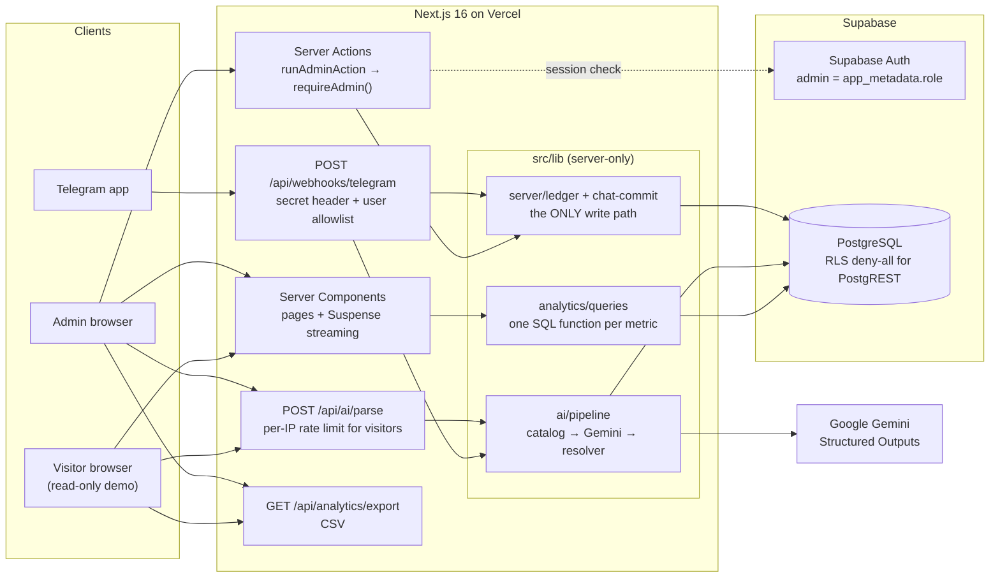
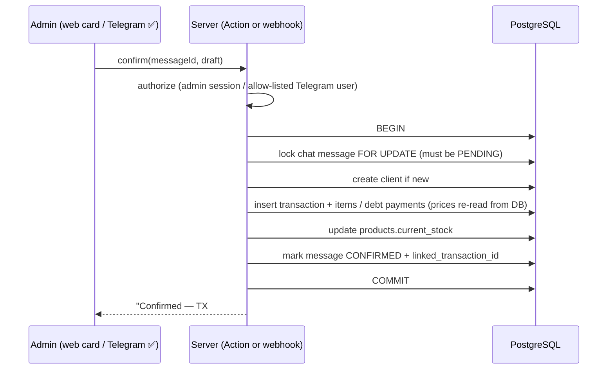
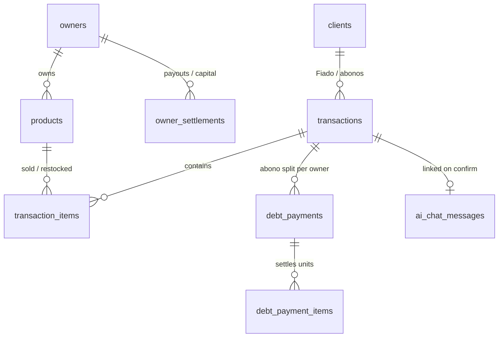

# BodegaOS

**Inventory, AI cashier and business intelligence for a real neighborhood shop.**

BodegaOS replaces a Telegram-bot + Google Sheets workflow used by a 4-owner *bodega* in Venezuela.
The owners type sales the way they talk, for example *"Fiado para Mariana: 2 platanitos y 1 chinoto"*.
Gemini turns the message into an editable confirmation card. One tap writes an auditable,
transactional ledger in PostgreSQL. 1,000+ historical spreadsheet rows were migrated and reconciled
to the cent.

It runs in two modes at once:
- **Daily operations** for the shop's admins.
- **A public, read-only portfolio demo**: no login wall. Visitors can try the AI cashier in a
  rate-limited sandbox, and nothing they do is saved.


> **Live demo:** _coming soon_ · **Admin access:** seeded accounts only (there is no public sign-up)

---

## Screenshots

| AI Cashier console | Analytics |
|---|---|
|  |  |
| **Ledger with voiding** | **Clients & Fiado** |
|  |  |
| **Telegram bot** | **Dark mode** |
|  |  |

<sub>Placeholders: drop PNGs into <code>docs/screenshots/</code> with these names.</sub>

---

## Highlights

**AI Cashier (`/`) — the model is a parser, not a source of truth**
- **Live context:** Gemini (Structured Outputs from a Zod schema) receives the live catalog: products
  with aliases, prices, stock and owners, plus client and owner names.
- **Postgres decides the numbers:** the model only extracts *references*. A server-side resolver
  validates every SKU, client and owner against Postgres and computes prices, totals and stock warnings
  itself. A prompt-injected "set the price to 1 Bs" is ignored.
- **Human in the loop:** an editable confirmation card (swap a product, fix a quantity, change the
  payment method or client). One click runs **one database transaction**.
- **Live answers:** questions like *"¿Cuánto debe Jonathan?"* are answered from live SQL, not generated
  text.
- **Chat history:** a persistent, messenger-style history in Postgres.
- **Visitor sandbox:** visitors get a real Gemini parse with a 5-requests/hour per-IP limit, and a
  simulated commit.

**Telegram bot: the same brain, another door**
- **Same pipeline:** `/api/webhooks/telegram` reuses the exact parser and the exact commit function as
  the web.
- **Locked down:** the webhook checks a constant-time secret header, a per-user allowlist and
  `update_id` de-duplication.
- **Confirm from the chat:** **✅ Confirm / ❌ Cancel** inline buttons commit atomically.
- **One shared feed:** messages appear in the web console's live feed, and confirming on either side
  updates the other.

**A ledger you can audit**
- **Exact money:** every amount is `numeric(12,2)`, and math runs in integer cents.
- **Snapshots:** price and cost are snapshotted per line item, so price changes never rewrite history.
- **Void, never delete:** voiding reverses stock deltas atomically, and debt reverses automatically.
- **Inflation-aware Fiado (credit):** debt is tracked in *units* and re-priced at today's price.
  Payments settle whole units, oldest first, and any remainder is kept as credit.

**Power BI-style analytics (`/analytics`)**
- **Shared slicers:** filters live in the URL (period, owner, payment method, category), and every
  visual renders the same slice.
- **KPIs:** period-over-period deltas, gross margin, and owner ROI spotlight tiles.
- **Charts:**
  - revenue vs. profit over time;
  - top products;
  - owner comparison;
  - payment mix;
  - weekday × hour heatmap;
  - a stockout watchlist (days left at the current sell-through rate).
- **Every chart has a Table view:** an accessible twin. The palette is validated for color-vision
  deficiency in light and dark mode.
- **CSV export** of any filtered dataset, guarded against spreadsheet formula injection.

**Polish**
- EN/ES dictionary toggle (no locale-prefixed routes), light/dark mode, and mobile layouts for every
  table.
- Loading skeletons, error boundaries, OpenGraph image, and semantic design tokens.

---

## Architecture



**Confirm flow (web or Telegram, same code):**



### Data model



`client_debt_balances` is a SQL view and the single definition of debt:
Σ(units owed × today's price) − cash credit, with voided rows excluded.

---

## Security model

| Concern | How it's handled |
|---|---|
| Public demo vs. writes | Every Server Action goes through `runAdminAction()` → `requireAdmin()` (verified Supabase session **and** `app_metadata.role === "admin"` or an `ADMIN_EMAILS` allowlist). Hiding buttons in the UI is cosmetic only. |
| Visitors using the AI | `/api/ai/parse` writes **nothing** for visitors and is limited to 5 requests/hour per IP. The simulated commit never reaches the server. |
| Telegram | Constant-time `X-Telegram-Bot-Api-Secret-Token` check, per-user allowlist on every message **and** button tap, private chats only, `update_id` de-duplication. |
| Direct DB access | RLS is enabled on every table with no policies (deny-all for PostgREST/anon). The app talks to Postgres server-side through Drizzle. |
| Secrets | `GEMINI_API_KEY`, `DATABASE_URL` and the Telegram token are read only in `server-only` modules. A production-bundle scan finds **no** secret names or values in `.next/static`. |
| LLM output | Schema-constrained, Zod-validated, then resolved against Postgres. Prices and stock never come from the model, and a human confirms every write. |
| CSV export | Cells that would start a formula (`= + - @`) are neutralized. Exports are rate-limited. |

---

## Tech stack

| Layer | Choice |
|---|---|
| Framework | Next.js 16 (App Router, Cache Components, Partial Prefetching), React 19, TypeScript strict |
| UI | Tailwind CSS v4, shadcn/ui (Radix), Lucide, `next-themes` |
| Tables & charts | TanStack Table v8, Recharts 3 via shadcn charts |
| Data | Supabase Postgres (transaction pooler), Drizzle ORM (`postgres` driver), Zod |
| Auth | Supabase Auth via `@supabase/ssr` (seeded admins only) |
| AI | Google Gen AI SDK (`@google/genai`), Gemini Flash-Lite, Structured Outputs |
| Messaging | Telegram Bot API (webhook + inline keyboards) |
| Hosting | Vercel Hobby (free tier end-to-end) |

---

## Project structure

```
src/
  app/                  routes: / (AI Cashier), /inventory, /transactions, /clients, /owners, /analytics
    api/ai/parse        Gemini parse endpoint (admin: persisted · visitor: sandbox)
    api/webhooks/telegram
    api/analytics/export
  actions/              Server Actions per domain (all admin-guarded)
  db/                   Drizzle schema + SQL migrations
  lib/
    ai/                 Gemini client, prompt, catalog context, resolver, live answers
    server/             action wrapper, ledger write path, chat commit
    telegram/           webhook auth, Bot API client, card rendering, sync
    analytics/          slicers, metric queries, CSV
    clients/ inventory/ transactions/ owners/   domain queries + shared types
    i18n/               typed EN/ES dictionaries
  components/           feature components + shadcn/ui
scripts/                Sheets ETL import, sample seed, AI smoke test, Telegram webhook setup
docs/PHASES.md          build log: decisions, gotchas and verification per phase
```

---

## Local setup

**Prerequisites:** Node.js 20+, a Supabase project, and a Gemini API key. A Telegram bot token is
optional.

```bash
git clone https://github.com/JavierS123/bodega-website.git
cd bodega-website
npm install
cp .env.example .env    # then fill it in (see below)
```

**Environment variables** (`.env.example` documents each one):

| Variable | Required | Notes |
|---|---|---|
| `DATABASE_URL` | ✅ | Supabase **transaction pooler** (port 6543) |
| `DIRECT_URL` | – | Session pooler (5432) for `drizzle-kit` |
| `NEXT_PUBLIC_SUPABASE_URL`, `NEXT_PUBLIC_SUPABASE_ANON_KEY` | ✅ | Auth |
| `ADMIN_EMAILS` | ✅ | Comma-separated admin emails (or set `app_metadata.role = "admin"`) |
| `GEMINI_API_KEY` | ✅ | Server-side only. `GEMINI_MODEL` optionally overrides the model |
| `TELEGRAM_BOT_TOKEN`, `TELEGRAM_WEBHOOK_SECRET`, `TELEGRAM_ALLOWED_USER_IDS` | – | Telegram bot |
| `NEXT_PUBLIC_SITE_URL` | – | Absolute URL for OpenGraph images (defaults to the Vercel domain) |

**Database:**

```bash
npm run db:migrate                         # apply src/db/migrations to a fresh database
npx tsx scripts/seed-sample.ts             # optional: small fake dataset through the real import pipeline
# or import real Google Sheets CSV exports (scripts/data/*.csv, gitignored):
npx tsx scripts/import-sheets.ts --dry-run # audit report first, then run without --dry-run
```

Create an admin user in **Supabase → Authentication → Users**. Then either list that email in
`ADMIN_EMAILS` or set the user's `app_metadata.role` to `"admin"`.

**Run:**

```bash
npm run dev        # http://localhost:3000
```

**Telegram (after deploying to an HTTPS URL):**

```bash
npm run telegram:webhook -- set https://<your-app>.vercel.app   # registers webhook + secret + bot commands
npm run telegram:webhook -- info
```

Message the bot. If your ID isn't allow-listed yet, it replies with your Telegram user ID so you can
add it to `TELEGRAM_ALLOWED_USER_IDS`.

### Scripts

| Command | What it does |
|---|---|
| `npm run typecheck` / `npm run lint` / `npm run build` | Quality gates (all clean) |
| `npm run db:generate` | Generate a SQL migration from `src/db/schema.ts` |
| `npx tsx --conditions=react-server scripts/ai-smoke.ts ["message"]` | Live parser smoke test against Gemini + the DB (read-only) |
| `npm run telegram:webhook -- set <url> \| info \| delete` | Manage the Telegram webhook |

---

## Engineering notes

- **One write path:** `src/lib/server/ledger.ts` is the only code that writes sales, abonos and
  restocks. Manual forms, the web AI card and Telegram all call it inside a caller-owned
  `db.transaction`.
- **Verified against reality:** the Sheets migration reconciles every client's debt and every owner's
  cash/bank balance exactly with the original spreadsheet. Analytics totals agree across the time
  series, products, heatmap and line-level CSV.
- The full build log, with the decision, gotchas and verification for each phase, is in
  [`docs/PHASES.md`](docs/PHASES.md).
